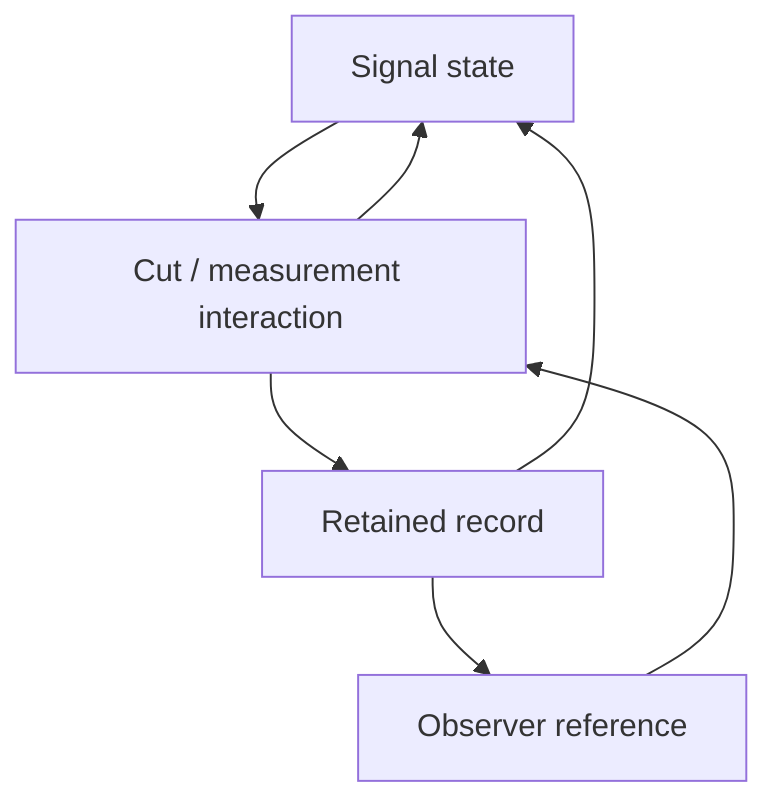

# Moving observer, changing signal, and retained records

Author: Monty. Calculator experiment: 2026-10-31.
Status: exact finite circuit tests and a proposed continuous extension;
no calibrated material dynamics or computational advantage established.

The next implemented stage is the [record-controlled phase tracker](OBSERVER_TRACKING.md):
a frozen observer chooses later measurement axes from earlier bits and is
compared against a searched rotating schedule with the same six-probe budget.
The [joint-state extension](OBSERVER_STATE.md) also changes transverse Bloch
contrast through a declared source channel, checks affine frame transport
and the Coriolis identity, and retains comparisons against the phase-only
measurement tree with a joint decoder.

The observer can be an evolving part of the machine. Its reference need not be
an externally fixed axis. The operational state then includes **signal,
reference, and retained interaction records**. A useful design question is how
the record changes the next measurement and the signal's subsequent evolution.
Rotating both descriptions consistently must still preserve the same physical
predictions. Physical interaction, relative phase motion and a change of
coordinates must remain separately identifiable.

## 1. Connect to the existing cut, without replacing its meaning

The existing [phase-seam foundation](../phase_seam_foundation/FOUNDATION.md)
defines a classical phase carrier and the proposed oriented cut family

\[
J_c(z)=e^{2ic}\overline z,\qquad
J_c^2=I,\qquad
J_dJ_c(z)=e^{2i(d-c)}z.
\]

Thus two oriented reflections give transport. On the grid with phase spacing
2*pi/L, the cut-axis spacing is pi/L; these are different resolutions. The
event record survives even when two operations restore the carrier.

Here `c` is geometric cut orientation. Separately, `a` is the physical analyzer
phase of the quantum-compatible experiment below. A mapping a=g(c, device
state) needs an explicit encoding and calibration. This note does not infer
it by reusing an angle symbol. A reversible reflection and a measurement
instrument also have different roles: an instrument specifies outcome
probabilities, state change and a retained record.

The anti-linear J_c is valid on the declared classical coordinates. It is not
installed as a deterministic gate conjugating arbitrary unknown quantum
amplitudes. The existing foundation supplies a negative complete-positivity
witness for that identification. This experiment uses allowed phase gates,
Hadamards and controlled gates throughout.

## 2. The natural observable is a relation

For a scalar carrier z=r*exp(i*phi) and reference phase a, define

\[
q=e^{-ia}z,\qquad \delta=\phi-a,
\qquad
\dot q=e^{-ia}\dot z-i\dot a\,q.
\]

For pure phase transport, dot(z)=i*omega_s*z, this gives

\[
\dot\delta=\omega_s-\dot a.
\]

A common time-dependent shift phi->phi+chi(t), a->a+chi(t) leaves delta
unchanged. The reference can move while the relative reading remains fixed.
If they move at different rates, the reading changes. In particular, wrapping
delta modulo 2*pi loses the distinction between full turns; retaining path or
crossing records is an additional memory requirement.

For the explicitly assumed equatorial qubit preparation and analyzer,

\[
|\psi_\phi\rangle=(|0\rangle+e^{i\phi}|1\rangle)/\sqrt2,
\qquad p(0\mid\phi,a)=\frac{1+\cos(\phi-a)}2.
\]

This probability law uses the usual quantum measurement postulate. It is not
derived from the classical cut identity. It also does not define every kind
of information as one phase: information about a target depends on what can
be reconstructed from available records and declared later operations.

## 3. A moving reference needs its connection term

For |psi_O>=V(t)^dagger|psi>, differentiating gives

\[
H_O=V^\dagger H V-i\hbar V^\dagger\dot V.
\]

The last term accounts for reference motion. Omitting it while using a
time-varying basis changes the model. The exact discrete counterpart is

\[
U^{(O)}_j=V_j^\dagger U_j V_{j-1}.
\]

Intermediate frame factors cancel in the product, leaving the same physical
evolution with transformed endpoints. This is checked with noncommuting
Hadamard/phase blocks, both a moving schedule and a static schedule. The
deliberately incorrect rule V_j^dagger U_j V_j disagrees for the moving
schedule and agrees for the static one. A moving reference cannot by itself
produce extra information or bypass simulation resource costs.

This scalar/classically controlled frame test is narrower than a fully
quantum reference frame. For broader relational quantum reference frames,
see [Giacomini, Castro-Ruiz and Brukner](https://arxiv.org/abs/1712.07207).

## 4. Make the reference and information-bearing state affect each other

An operational discrete model is

\[
p(b_k)=\operatorname{Tr}(K_{b_k}(a_k)\rho_k K_{b_k}(a_k)^\dagger),
\quad
\rho_k^+=\frac{K_{b_k}(a_k)\rho_k K_{b_k}(a_k)^\dagger}{p(b_k)},
\]
\[
m_{k+1}=F(m_k,b_k),\quad
a_{k+1}=G(a_k,m_{k+1}),\quad
\rho_{k+1}=U(m_{k+1})\rho_k^+U(m_{k+1})^\dagger.
\]

The normalized conditional state is defined only for outcomes of nonzero
probability. Completeness sum(K_b^dagger K_b)=I is required. The record controls
the next analyzer and optionally the source. This explicitly accounts for
measurement backaction; the controller does not obtain an unknown quantum
phase for free. Quantum measurement feedback has an established literature,
including [Wiseman's thesis summary](https://arxiv.org/abs/quant-ph/0309045).



The calculator implements a minimal two-read experiment. Prepare phi=pi/2;
measure first at a1=0, retaining b1; evolve by pi/2+gamma*b1; measure again
at a2=beta*b1. One signal wire and two fresh record wires suffice. Deferred
measurements keep each record as an untouched computational-basis control.
Final joint record probabilities match an independent sequential-projector
calculation, including conditional state change. No record is postselected.

| Record-dependent source phase gamma | Record-dependent observer phase beta | Exact P(b2=1) |
| --- | --- | ---: |
| 0 | 0 | 1/2 |
| 0 | pi/2 | 3/4 |
| pi/2 | 0 | 1/4 |
| pi/2 | pi/2 | 1/2 |

Only the relative increment gamma-beta affects this declared second read.
The 3/4 value is an output probability, **not a classification score**. With
the first recording interaction disabled, b1 remains zero and P(b2=1)=1;
recording itself therefore has a measurable backaction in this model. That
control removes the interaction; it is not an unaccounted erasure/reset.

## 5. A continuous candidate for a hardware emulator

The following is a new proposed law to test, not a measured transistor law:

\[
\dot\phi=\omega_s-\lambda k_s\sin\delta,
\quad
\dot a=\omega_o+k_o\sin\delta+\eta m,
\quad
\tau\dot m=-m+\sin\delta.
\]

Then

\[
\dot\delta=\Delta\omega-(\lambda k_s+k_o)\sin\delta-\eta m.
\]

Here m retains phase-error history; it changes how the observer follows the
signal. Lambda=0 removes the proposed feedback force on the source. It does
not grant nondisturbing access to arbitrary unknown quantum states: this
continuous equation assumes a classical phase detector reporting sin(delta),
or an explicitly costed estimator supplying it. The exact circuit above uses
actual record-conditioned probabilities instead of that oracle assumption.

Writing K=lambda*k_s+k_o, a phase-locked solution satisfies
sin(delta*)=Delta(omega)/(K+eta), m*=sin(delta*). For K>=0, eta>=0,
K+eta>0 and tau>0, the branch with cos(delta*)>0 is locally stable: its
linearized trace is -K*cos(delta*)-1/tau and determinant
(K+eta)*cos(delta*)/tau. This establishes a local property of the proposed
equations, not global stability, material realizability or an advantage.

The attractive engineering target is a cell that records relative lag, uses
it to choose the next reference, and exposes a controlled influence on the
signal. Removing the memory or one feedback direction should remove a
specific predicted behaviour. Its work, noise, latency, memory and reset
costs then have to be compared with an ordinary phase detector/controller.

## 6. What “rotation” asks of hardware

Mechanical rotation is one possible physical operation, but these experiments
require programmable relative phase and a record-controlled analyzer. In the
existing [photonic hardware contract](../phase_seam_foundation/HARDWARE_CONTRACT.md),
phase channels, interferometers, reference calibration and records are already
separate interface roles. An electrical emulator could use a tunable oscillator
reference and a phase detector; the device-specific transfer function remains
to be supplied. Changing a software angle is not evidence that hardware follows
it with the required noise, range or bandwidth.

The viable general principle is **consistent transformation of signal,
reference, interactions and records**. A universal nonzero observer effect
does not follow: co-rotation leaves relative outcomes fixed, and a maximally
mixed qubit remains 50/50 for every tested analyzer angle. The fixed laboratory
frame remains a valid description, while the moving frame can make relational
dynamics easier to organize.

## 7. Retained exact evidence

All 47 calculator requests completed: 16 common rotations, 16 relative
rotations, 4 mixed-state controls, 6 frame-transport cases, and 5 record-feedback
cases. All 13 declared checks passed, with 47 optional Qiskit Statevector
cross-checks; maximum displayed-probability discrepancy was below 4.82e-13.
The tests additionally compare three parameter settings against explicit
sequential projective measurements and check the scalar cut-pair algebra.

Implementation: [moving_observer.py](moving_observer.py).
Retained [archive](../benchmarks/records/moving_observer_20261031.tar.gz) and
[index](../benchmarks/records/moving_observer_20261031.summary.json) include all
requests, exact field values, decimal enclosures, references and hashes.

```bash
python -m native_relational_qc.moving_observer --out /tmp/moving-observer-replay --compare-qiskit
```

Use a new output directory. Omit --compare-qiskit for the NumPy-only core.
No quantum service is contacted. This audit establishes finite algebra and
circuit semantics. Continuous coupled dynamics, physical calibration,
pattern-learning improvement and 64-bit workload scaling are separate tests.
