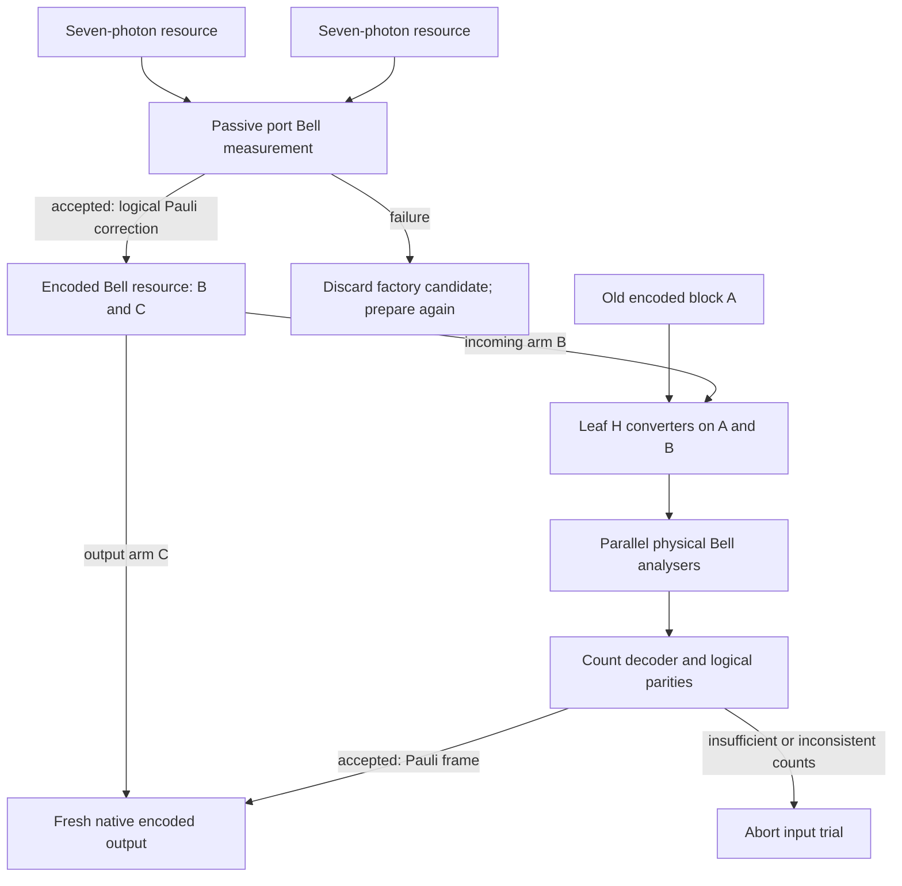

# Encoded optical Bell transfer from detector records — v0.32

**Author: Monty.** This follows classifier build v0.31 (`78a7599`) and optical
refresh v0.30 (`0d6dc92`) on `photonic-temperature-evidence-20261026`. The
classifier compiler v0.29 (`4b17975`) supplies its exact heater interface;
v0.31 supplies the Pauli-frame/angle-adaptation identity. Their code and
evidence remain unchanged. This revision connects both interfaces to the
native tree code, passive Bell instrument and seven-photon resource factory.

[Code](encoded_bell.py) · [Tests](../tests/test_phase_seam_encoded_bell.py) ·
[Audit](../benchmarks/encoded_bell_audit.py) ·
[Results](encoded_bell/qualification.json) ·
[Optical plan](encoded_bell/netlist.json) · [Test log](encoded_bell/test_results.txt).

## 1. Closed gates, open gates and assumptions

**Closed in the ideal model:** a coherent graph-to-parity basis converter;
the actual coarse optical measurement including unresolved outcomes; a
classical count-record decoder without a nondestructive erasure oracle;
an encoded transfer channel checked against an external reference; an exact
independent-loss success law; a fully encoded six-plus-six-photon Bell
resource and a restart ledger including failed preparation attempts.

For the six-photon `[2,2]` code, lossless transfer rises from the v0.30
single-port analyser's **1/2 to 3/4**, with conditional entanglement fidelity
1. The online input uses 18 photons, and the supplied resource uses 12.
Its stated ideal factory costs **192 expected Bell pairs**, compared with
48 for v0.30's smaller seven-photon resource. Success improves at a higher
resource cost; no resource-efficiency advantage is inferred from 3/4 alone.

**Open:** a nonzero-loss resource factory, measured source quality and
indistinguishability, detector dark counts and multipair faults, phase and
routing calibration, total preparation/feedback latency, and experimental
transfer. Larger code shapes assume supplied correct encoded Bell resources;
this revision certifies an explicit factory only for `[2,2]`.

**Assumptions:** exact indistinguishable-photon interference, uniform
independent photon loss, resolved detector counts, ideal single-photon
controls and feedforward, and correctly populated source states. The budget
uses full-resource-or-no-launch supply. It does not model partial faulty
sources as a harmless reduction in availability. Fresh output loss can be
unheralded. The shared classifier connection is the coherent heater
interface; an encoded classifier pipeline remains future work.

## 2. Claude's heater interface, used coherently

The existing `cluster_compile.heater_setting(0)` selects the X measurement
basis using phase steps `(lower, upper, before, after) = (16,0,32,48)` on
the native `pi/32` grid. That is appropriate before terminal photon counts:
output phases do not change the detector probabilities.

A reusable coherent H needs its full complex matrix. The new certificate
checks that matrix and removes 16 steps of relative output phase, yielding
`(16,0,32,32)`. The resulting unitary is H up to a single global phase.
All four entries are checked in the existing exact cyclotomic field.
This is a component-level interface extension, not a correction to the
classifier's terminal measurement rule. No physical heater voltages or
temperature calibration are asserted.

## 3. The tree code exposes block parity

Let the native depth-two tree have branching `[b,c]`, group size `s=c+1`
and `n=bs` physical photons per logical qubit. Apply H to each leaf of
both blocks that enter the logical Bell measurement. The code states become

\[
 |0_L\rangle=|\mathrm{GHZ}_+^{(s)}\rangle^{\otimes b},\qquad
 |1_L\rangle=|\mathrm{GHZ}_-^{(s)}\rangle^{\otimes b}.
\]

This follows directly from the existing encoder, rather than changing its
logical information. In this basis the native logical operators are

\[
 X_L=\prod_{g=1}^b Z_{g,1},\qquad
 Z_L=\prod_{j=1}^s X_{g,j}\quad\text{for any one group }g.
\]

Run one passive Bell analyser on each corresponding photon pair from the
old block A and the incoming resource arm B. An encoded Phi+ between B
and a fresh block C supplies the teleportation resource. C stays in the
original native graph-code basis.



The offline source retry consumes no unknown input. Online failure consumes
the old block; it cannot be retried by recreating that unknown state.

## 4. What the optical detector really reports

The v0.30 two-coupler mode circuit has ten two-photon output patterns.
Summing its exact Fock-derived row outer products yields three effects:

\[
 E_0=|00\rangle\langle00|+|11\rangle\langle11|,\qquad
 E_\pm=|\Psi^\pm\rangle\langle\Psi^\pm|.
\]

They sum to the identity. The even effect provides `ZZ=+1` and **no XX bit**.
The odd effects provide `ZZ=-1` and distinguish `XX=+1` from `XX=-1`.
The two ideal zero-amplitude patterns are rejected as inconsistent records.

`decode_counts()` receives four mode counts for every physical pair:

1. Fewer than two detected photons marks that pair incomplete. It contributes
   no parity information; remaining detector-path information is ignored.
2. Every group needs at least one complete pair to determine its common ZZ
   parity. Contradictory ZZ reports in a group reject the record.
3. At least one group must have all `s` pairs complete and odd. Select the
   first such group and multiply its XX results.
4. XOR the group ZZ bits to obtain the logical XX bit. XOR the selected
   group's XX bits to obtain the logical ZZ bit. Apply logical
   `X^(logical ZZ bit)` then `Z^(logical XX bit)` to C.

This identifies losses destructively from counts; it assumes no external
loss flags and uses no adaptive quantum measurement bases. Excess photon
counts, group ZZ contradictions and inconsistent XX parities among complete
odd groups reject the run. Some physical
faults can still mimic valid records: this is not a general error detector.

The native dynamic witness uses a full Clifford Bell-reference measurement
and ignores its even-sector phase bit. This is valid because the measured
photons are consumed: coarse-graining those outcomes gives exactly `E_0`.
That reference CNOT is not a physical component in the optical plan.
Incomplete pairs are traced, equivalent to summing their ignored records
in the declared uniform-loss model.

### Handoff to Claude's heater-only readout

The accepted output need not undergo active physical Pauli corrections if
its next operations are local equatorial measurements. `measurement_handoff`
expands the two logical frame bits using the native `X_L,Z_L` masks. For
each output photon it then reuses `cluster_build.adaptation_lemma`:

\[
 B(a)\longmapsto B((-1)^x a),\qquad s\longmapsto s\oplus z.
\]

The actual heater setting comes from the shared `heater_setting` interface.
For example, logical frame `(1,1)` puts a physical `(X,Z)` frame on photon 0
of `[2,2]`; nominal angle 5 becomes 59 steps and its raw outcome is flipped.
The exported heater `before` setting is then 37 steps. Independent exact
projector tests compare these exported readouts with active corrections,
and optical matrix tests check their detector rails.

This is a concrete output-frame interface to v0.31. It covers subsequent
single-photon equatorial readouts with **no intervening gates**. Frames must
also be propagated through any intervening gates, and compiling an encoded
logical classifier or arbitrary logical measurement is a separate task.
The Bell-transfer measurement bases themselves remain static.

## 5. Exact success and coherent transfer

For a fixed incomplete-pair mask, reject if any group has no complete pair.
Otherwise let `r` be the number of fully complete groups. Their block ZZ
parities are uniformly distributed for teleportation through the supplied
encoded Bell resource. Success requires at least one odd complete group:

\[
 P_{\rm success\mid mask}=1-2^{-r}.
\]

The first-odd-group events are disjoint. The exact witness sums every one;
it does not select only a favourable detector branch. With no losses,

\[
 P_{\rm success}=1-2^{-b}.
\]

| Native code | Physical photons per logical block | Ideal transfer success | Resource scope |
| --- | ---: | ---: | --- |
| `[2,2]` | 6 | 3/4 = 75% | Explicit 12-photon Bell factory below |
| `[3,2]` | 9 | 7/8 = 87.5% | Correct 18-photon Bell resource assumed |
| `[4,3]` | 16 | 15/16 = 93.75% | Correct 32-photon Bell resource assumed |
| `[8,1]` | 16 | 255/256 = 99.609375% | Correct 32-photon Bell resource assumed |

These are success probabilities for transferring **one encoded logical
qubit**, not qubit counts, physical accuracy measurements or scalable-system
performance. Each listed shape has an exact external-reference witness
with accepted entanglement fidelity 1. The six-photon case retains fidelity
1 on all 13 recoverable pair-erasure masks; no-loss success is 3/4, and each
of the other twelve masks succeeds with probability 1/2. The remaining
masks reject. With feedback removed, the no-loss witness has fidelity 1/6.

Independently, the compact-state engine prepares all four logical Bell
states, enumerates every nonzero physical Bell-reference record and checks
the count decoder under all 64 six-pair erasure masks. This verifies the
correction bits and success probabilities separately from the dynamic Choi
witness and closed-form probability calculation.

## 6. Independent loss law and latency

Let `eta` be the probability that a physical pair supplies both photons and
both detector clicks. For one group, at least one pair survives with
probability `A=1-(1-eta)^s`; a fully complete odd group has probability
`B=eta^s/2`. Independence across groups gives

\[
 P_{\rm logical}(\eta)=A^b-(A-B)^b.
\]

For `[2,2]` this is `3 eta^4 - 3 eta^5 + (3/4) eta^6`. A separate enumeration
over every pair-loss mask gives Bernstein numerators `[3,12,12,0,0,0,0]`
with denominator 4. Enumeration and the closed form agree exactly for all
tested shapes through 16 physical photons and the stated rational inputs.

With photon survival `m` per round, old storage `t`, pre-Bell wait `u`,
post-Bell wait `v`, uniform detector efficiency `d` and full-resource
availability `q`, the budget uses

\[
 \eta=m^{t+2u}d^2,\qquad
 P_{\rm herald}=qP_{\rm logical}(\eta),\qquad
 P_{\rm herald\ and\ intact}=P_{\rm herald}m^{n(u+v)}.
\]

Incomplete pairs are already included in `P_logical`; multiplying another
`d^(2n)` would double-count detector loss. Uniform attenuation can be moved
through the ideal passive network; unequal mode efficiencies are outside
this scalar model. A fresh-payload loss need not alter the measured pairs,
so the herald alone does not certify an intact output or physical fidelity 1.

Declared `[2,2]` comparison, full-resource availability 1 in both designs:

| Conditions | v0.30 fixed decoder: herald | Encoded: herald | Encoded: herald and intact output |
| --- | ---: | ---: | ---: |
| Ideal, no wait | 0.500000 | 0.750000 | 0.750000 |
| Detector efficiency 0.9; no storage loss | 0.295245 | 0.457188 | 0.457188 |
| `m=0.99`, `t=10`, detector efficiency 0.9, `u=v=0` | 0.197511 | 0.346953 | 0.346953 |
| Same, with `u=v=1` | 0.193580 | 0.327556 | 0.290341 |

The designs have different resource costs and unmeasured preparation times;
these comparisons are model transfer rates, not throughput or price claims.
More redundancy is not uniformly better: at complete-pair survival 1/2,
`[8,1]` gives about 0.076830 while `[3,1]` gives about 0.177734. The audit
includes an exact scan of admissible shapes, without claiming their sources
are equally available or equally cheap.

## 7. Fully encoded Bell factory and online photon cost

Prepare two v0.30 seven-photon resources, each Phi+ between one physical
port and a six-photon encoded block. Bell-measure the two ports using the
same passive analyser. Each of its four accepted patterns has probability
1/8 and produces an encoded Bell state on the twelve retained photons;
a recorded logical X/Z frame yields encoded Phi+.

The exact two-logical-qubit contraction proves every branch. An independent
native dynamic calculation checks the ten code stabilisers and the two
logical Bell stabilisers; all twelve independent generators have expectation
+1 after correction. The factory counts are `14 = 2 detected + 12 output`.

Under **prepare-both-first, discard-both-on-failure**, each swap attempt uses
two resources at 48 expected ideal Bell pairs each. The swap succeeds with
probability 1/2, so full renewal costs

\[
 E[N_{\rm Bell\ pairs}]=\frac{2\times48}{1/2}=192.
\]

That is 384 expected source photons, including the preceding factories'
failures. It assumes ideal Bell-pair inputs and zero source, storage and
switch loss. It is neither an optimum nor a fixed per-shot bill. Source
preparation time is not priced. No v0.29 conditional-on-success cluster-cost
estimate is imported as an unconditional factory cost.

Online `[2,2]` uses six old photons plus the twelve-photon resource:
`18 = 12 measured + 6 retained` when lossless. The component plan contains
six Bell analysers (12 couplers), eight coherent leaf-H units (16 couplers),
and 24 detector mode channels. The resulting 28-coupler count excludes the
offline factories and output Pauli routing. A single parallel Bell readout
and subsequent classical frame delivery are causal stages, not measured
clock-cycle or nanosecond latency claims.

## 8. Reproduce and continue

```sh
python benchmarks/encoded_bell_audit.py
```

The audit runs 26 new tests and the 68 preceding recovery, optical and
classifier compile/build tests (94 total), writes exact coefficients,
quantum witnesses, source hashes and a component plan, and records all
failures and rejected branches.
The earlier audit files remain historical snapshots.

The next engineering gate is a **loss-aware encoded-resource factory and
fault budget**: quantify how partially populated resources, multipair
emission and imperfect interference affect the accepted output, then price
verified supply and waiting. High intrinsic Bell success alone cannot close
that gate or establish room-temperature hardware operation.

## 9. Prior art and attribution

The quantum parity-code route and its linear-optical logical Bell idea are
established. The contribution here is the checked native-code basis map,
Fock-instrument/count-decoder connection, repository integration, explicit
factory policy and reproducible exact witnesses.

- Ewert, Bergmann and van Loock, *Ultrafast Long-Distance Quantum Communication
  with Static Linear Optics*, [arXiv:1503.06777](https://arxiv.org/abs/1503.06777).
- Schmidt and van Loock, *Efficiencies of logical Bell measurements on CSS
  codes with static linear optics*, [arXiv:1812.09278](https://arxiv.org/abs/1812.09278).
- Hilaire et al., *Linear optical logical Bell state measurements with optimal
  loss-tolerance threshold*, [arXiv:2302.07908](https://arxiv.org/abs/2302.07908).
