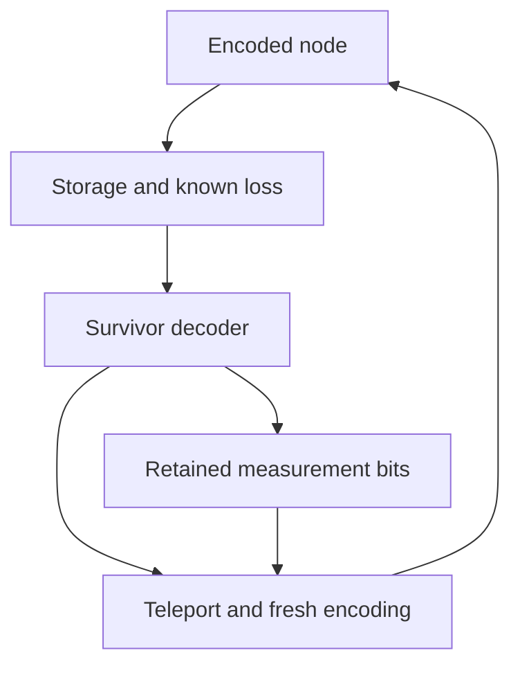

# Age-aware memory and coherent transfer to a fresh node — v0.28

**Author: Monty.** This continues v0.27 commit `dcefc8f` on
`photonic-temperature-evidence-20261026`. That revision prices an initial
encoded resource. This revision supplies the missing distinction between
building a resource and renewing the unknown logical state stored in it.

[Code](loss_refresh.py) · [Tests](../tests/test_phase_seam_loss_refresh.py) ·
[Audit](../benchmarks/loss_refresh_audit.py) ·
[Reproducible results](refresh/qualification.json) · [Test log](refresh/test_results.txt).

## 1. Closed, open, and added assumptions

**Closed in the declared model:** exact accumulation of independent photon
loss; a constructive depth-two tree decoder using surviving photons; an
explicit decode/teleport/re-encode circuit with a retained external reference;
an exact lifetime/resource budget with separate supply, transfer and latency
inputs; rejection of impossible evidence probabilities and tolerances.

**Open:** mapping this decoder and teleporter to the probabilistic optical
fusion hardware; generation of its encoded resources; nondestructive loss
flags or a loss-aware measurement protocol; measured latency, fidelity,
correlated loss and source noise; a physical repeated-refresh demonstration.
No encoded optical node has been built or measured here.

**Added assumptions:** the circuit uses ideal deterministic CNOTs, H gates,
Z measurements and classical feedforward. An erased photon is a known partial
trace, represented by an inaccessible reset placeholder in the calculator.
The budget assumes input-independent heralded transfer success and an ideal
identity channel conditional on that success. Whole-resource readiness is
independent of old-block erasures and already includes fresh-block buffer and
switch survival. None of these engineering inputs is a recorded measurement.

## 2. Theorem R1: stored photons age until they are replaced

Let `P(e)` be v0.26's exact both-logical recovery polynomial and `m` the
independent per-photon survival probability for one round. For one unchanged
block stored for `t` rounds,

\[
 P_{\rm stored}(t)=P(1-m^t).
\]

Proof: a physical photon survives all rounds with probability `m^t`;
different photons remain independent. Insert this composed erasure rate into
the existing enumeration. Correctable loss sets are downward closed, so a
block correctable at the end was correctable earlier too. A separate test
sums all 64-by-64 two-round loss histories of the six-photon code using the
union of the lost sets, independently of the composed-rate evaluation.

`P(1-m)^t` instead assumes that every successful round ends in a fresh full
block. A lost photon does not return merely because its logical information
remains recoverable.

For `[4,3]`, `m=99/100`, 50 rounds:

| Model | Recoverability / completion probability |
| --- | ---: |
| Same block; no replenishment | 0.404267148431 |
| Perfect fresh block after every round; free, instantaneous transfer | 0.999877467586 |

These are exact rational calculations displayed as decimals. The API retains
the large rational composed loss rather than rounding it to fit the older
single-round API's input-bit limit. Storage is bounded to 256 rounds.

## 3. Theorem R2: an explicit surviving-photon decoder

For branching `[b,c]`, partition the photons into `b` groups: each parent and
its `c` leaves. Applying H to each leaf takes the tree code to a concatenated
repetition code. In this representation a codeword is

\[
 \alpha\,|\mathrm{GHZ}_+\rangle^{\otimes b}
 +\beta\,|\mathrm{GHZ}_-\rangle^{\otimes b}.
\]

Both logical operators are available exactly when:

1. Every group has at least one surviving photon.
2. At least one group is completely intact.

The first condition supports `X_L`: a lost parent can be replaced by a
surviving leaf through its stabiliser. `Z_L` requires an intact group. The
constructive criterion agrees with the separate GF(2) support solver for
every erasure pattern of `[2,2]`, `[3,2]` and `[3,3]`.

Choose an intact group. Undo H on surviving leaves, measure one survivor in
every other group in Z, undo the intact group's GHZ fanout, and apply H to
its parent. If the retained measurement parity is `p`, the output is
`alpha|0> + (-1)^p beta|1>`; a recorded Z correction recovers the input.
The rest of the state, including any loss environment, is then independent
of the input. The decoder never addresses an erased wire.

An independent closed form follows for this depth-two family, with group
size `s=c+1`:

\[
 P(e)=(1-e^s)^b-\bigl(1-e^s-(1-e)^s\bigr)^b.
\]

The first term excludes wholly lost groups; the second excludes configurations
with no intact group. The implementation retains the existing stabiliser
enumeration as its probability source.

## 4. The coherent node milestone

The circuit prepares an input entangled with an untouched external reference,
encodes it, traces out the declared lost photons, executes the decoder, and
teleports the output into a new block's input using an explicit Bell pair and
two retained measurement bits. It then encodes the new block. Every quantum
measurement branch is averaged; none is postselected to improve fidelity.



The exact native dynamic observer measures `XX`, `YY`, `ZZ` against the
external reference after final decoding. Values `(1,-1,1)` give Bell/Choi
fidelity `(1+XX-YY+ZZ)/4=1`. Since the implemented channel is trace preserving,
this certifies the identity channel for arbitrary logical inputs, including
entangled inputs, **under the ideal circuit assumptions**.

| Check | Exact result |
| --- | --- |
| All 13 correctable masks of six-photon `[2,2]` | Bell fidelity 1 after transfer and re-encoding |
| All six possible single-photon losses | Included in the above exhaustive check |
| Two successive fresh-block transfers, three distinct schedules | Bell fidelity 1 |
| Corrections disabled | Bell fidelity 1/4 |
| Uncorrectable masks | Rejected before emitting a recovery circuit |

Thirteen means one no-loss pattern, six single losses, and six double losses.
The two-transfer calculator circuit has 20 allocated wires, while the declared
maximum live data/helper count is 13 plus one external reference. Reused
helper preparation and the retained measurement records are explicit. This
is a bounded coherent circuit demonstration, not a fabricated photonic chip.

## 5. Theorem R3: renewal must pay for supply, transfer and time

For storage interval `t_j`, transfer latency `d`, whole-resource readiness
`r`, and heralded transfer success `q`, define

\[
 p_j=P(1-m^{t_j+d})rq,\qquad
 P_{\rm complete}=\prod_j p_j.
\]

This is exact for independent cycles that reset the surviving logical state
to a full fresh block on success. Failure ends that input trial; an unknown
lost input cannot be retried. If a fresh resource/transfer attempt is reserved
at the start of each reached cycle at declared cost `C`, then

\[
 E[A]=\sum_j\prod_{i<j}p_i,\qquad E[\mathrm{cost}]=C E[A].
\]

The API reports both this early-abort expectation and the all-success path
cost. It explicitly excludes the supplied initial encoding. Resource cost
must include the actual fresh-resource generation and transfer; the circuit's
ideal gates do not imply free preparation.

Example sensitivity study: `[4,3]`, 50 useful storage rounds, `m=0.99`,
**declared** `q=r=0.99`, zero transfer latency. These 99% operating points
have not been implemented or measured.

| Storage rounds between refreshes | Transfers including final transfer | Completion probability |
| --- | ---: | ---: |
| 1 | 50 | 0.365987 |
| 2 | 25 | 0.604458 |
| 5 | 10 | 0.808773 |
| 10 | 5 | 0.849985 |
| 25 | 2 | 0.663705 |
| 50 | 1 | 0.396222 |

No-refresh recovery for the same 50 elapsed rounds is 0.404267. Ten rounds
is best **among these six candidates**, not a universal optimum. The audit
also includes transfer success 1/2 as a negative engineering control and
nonzero latency, comparing each schedule with no refresh over the same
elapsed time. Probabilities alone are not a resource-normalized advantage.

## 6. Corrections to v0.26 and v0.27

- `[3,3]` corrects every two-photon erasure, but only 156 of 220 three-photon
  erasures. TREE_CODE.md's stronger sentence and several table entries are
  corrected. `[4,3]` does correct every three-photon erasure in the ideal model.
- The old 64-site walk value near 0.756 is retained as an **ideal per-round
  renewal reference**. Flooring its effective survival is a numerical lower
  bound within that model, not a device lower bound. Encoded fusion success
  also needs its own physical derivation.
- v0.27's offline factory constructs a resource; it does not transfer the
  state of an old damaged block into it. Its approximate 543-Bell-pair figure
  is not the cost of repeatedly maintaining an unknown logical state. Star
  storage, switch/buffer loss, failed-build consumption and logical coupling
  require a full resource ledger; the current successful-build conditional
  cost estimate is not used as an exact cost here.
- `code_grade` rejects out-of-range recovery probabilities, tolerance 1,
  invalid witness counts and degenerate loss-only records. `build_grade`
  validates witness, survival and tolerance ranges and uses an explicit 1/2
  witness admission floor. These are record checks, not independent
  authentication of a claimed laboratory experiment or a complete physical
  fidelity certification.
- Original `code/qualification.json` and `build/qualification.json` remain
  historical audit outputs; their interpretation notices point to this
  correction. The new audit binds current source hashes and test results.

## 7. Reproduce and next physical target

```bash
python benchmarks/loss_refresh_audit.py
```

Next: compile the surviving-photon decoder and encoded logical transfer into
the actual optical gate set; count failed fusion attempts, ancillas, measured
loss flags, source/switch loss and latency. Use the six-photon node as the
first device target, and derive its `q`, `r`, `d`, and `C` before projecting a
large register or a room-temperature computer.

Prior work: tree-based loss tolerance and optical memory are established
directions. This revision contributes a reproducible implementation and
corrects the assumptions in this repository, not a claim to invent them:

- Varnava, Browne, Rudolph, [Loss tolerant linear optical quantum memory by
  measurement-based quantum computing](https://arxiv.org/abs/0705.1904), 2007.
- Bell, Pettersson, Paesani, [Optimizing Graph Codes for Measurement-Based
  Loss Tolerance](https://doi.org/10.1103/PRXQuantum.4.020328), 2023.
