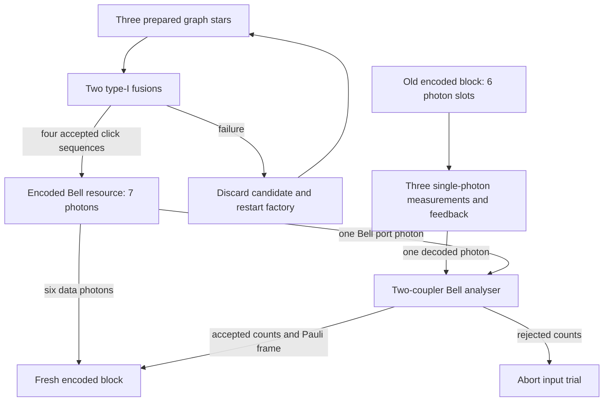

# Optical fresh-node transfer and encoded Bell factory — v0.30

**Author: Monty.** Builds on v0.28 `e391b9b` and follows the v0.29 classifier
compiler `4b17975` on `photonic-temperature-evidence-20261026`. This revision
connects the coherent decoder to passive optical components and derives its transfer probability.
The result is an **ideal optical circuit and reproducible calculation**, not
a fabricated device or measured operating point.

[Code](optical_refresh.py) · [Tests](../tests/test_phase_seam_optical_refresh.py) ·
[Audit](../benchmarks/optical_refresh_audit.py) ·
[Results](optical_refresh/qualification.json) ·
[Optical plan](optical_refresh/netlist.json) ·
[Test log](optical_refresh/test_results.txt).

## 1. What this adds

| Result | Verified scope |
| --- | --- |
| Decoder with no online two-photon unitary | Single-photon measurements, H and parity-controlled Z; all 13 correctable six-photon masks tested with an externally entangled input and a **known erasure map** |
| Two-coupler optical Bell analyser | All ten two-photon detector patterns included; four accepted patterns, each with probability 1/8; total transfer success **1/2** |
| Seven-photon encoded Bell resource | Three three-photon graph stars, two type-I attachments; all four successful detector sequences produce the target graph, each with probability 1/16 |
| Factory cost including discarded candidates | **48 expected ideal Bell pairs** per resource, under the stated full-restart policy and zero storage loss |
| A fixed circuit without an erasure oracle | Three decoder detections; four of 64 old-block loss masks can succeed; required missing clicks reject |
| Transfer budget with waiting and detector loss | Counts all five required detections and fresh-payload survival separately from the Bell herald |

The new optical instrument realizes the basic transfer at 50% success. The
v0.28 budget's 99% transfer setting remains an unachieved sensitivity example.

## 2. Architecture and photon ledger



The source retry loop is **offline**. It never retries or recreates a consumed
unknown logical input. The factory root is retained as a Bell port, unlike
the root-measured encoded site in v0.27.

For a full six-photon input, the online boundary contains 13 photons: six
old photons plus a supplied seven-photon resource. On success, three decoder
photons and two Bell photons are detected, two unused old photons are
discarded, and six fresh data photons remain: `13 = 5 + 2 + 6`. There are ten
detector mode channels, counting two rails per decoder measurement and four
Bell output modes. The JSON ledger subtracts already erased old photons
from both the input and the discarded count. It distinguishes allocated
slots from photons actually present.

Three causal stages are declared: decoder readout, Bell readout after decoder
feedback, and output Pauli-frame delivery. Their physical durations, routing,
switch loss and detector recovery times require measurements. No nanosecond
latency, chip area, wavelength adaptation or temperature performance follows
from this logical optical plan.

## 3. Measurement-only recovery

For the depth-two code `[b,c]`, choose one intact group (parent plus `c`
leaves). In that group measure every leaf in the original graph-basis Z.
Write their outcome parity as `s`. In every other group measure one survivor:
Z for a parent, X for a leaf. Write that parity as `p`.

Apply `Z^s`, then H, then `Z^p` to the selected parent. These are all
single-photon controls. To see why, first use the repetition-code form in
[v0.28](LOSS_REFRESH.md): a graph-basis leaf Z measurement is an X measurement
in the GHZ representation. The leaf outcomes leave a `Z^s` factor on the
parent. Removing it and applying H changes GHZ +/- into the original
computational coefficients. The other-group measurements contribute the
remaining `Z^p` factor. The two retained parities remove both effects.

The exact dynamic-engine witness keeps an external reference entangled with
the input. Lost photons are traced out; all decoder outcomes are averaged.
For all 13 correctable `[2,2]` masks, accepted transfer has entanglement
fidelity 1 and probability 1/2. Two successive transfers preserve conditional
fidelity 1 with **joint success 1/4**. Omitting feedback yields conditional
fidelity 1/4 in the declared negative control.

### Erasure information is an explicit resource

The 13-mask result selects the decoder using a **known loss map**. The circuit
does not create nondestructive loss flags. With no such map the supplied
fixed policy chooses group 0 and the other parents. For `[2,2]` it requires
old photons `{0,1,2,3}`; unused photons `{4,5}` may be absent. Its acceptable
loss masks are exactly `0,16,32,48`. Under independent per-photon survival
`s`, the fixed policy's old-input survival is `s^4`, not the oracle recovery
polynomial. A missing required photon fails the decoder or Bell detector
rule in the stated pure-loss/no-dark-count model.

The known-map decoder supports depth-two codes through 16 data photons. The
new resource factory is certified here **only for `[2,2]`**; larger circuit
witnesses assume a supplied correct encoded Bell resource.

## 4. Passive Bell instrument, including failures

Let the existing symmetric coupler be
`D = [[1,i],[i,1]]/sqrt(2)`. Input and output phase shifts of `-pi/2` on its
second mode give `P D P = H`. Apply these two-mode transformations to rails
`(0,2)` and `(1,3)` of `old0,old1,port0,port1`.

The existing exact Fock engine computes each two-photon amplitude in
`Q(zeta_64)`. Accept exactly one photon across output modes `(0,2)` and one
across `(1,3)`. These four patterns identify Psi+ or Psi-. Contracting each
row with a supplied encoded Phi+ resource gives a teleport Kraus operator
`K_j`. The emitted per-pattern X/Z correction obeys

\[
 C_jK_j=a_j I,\qquad |a_j|^2=1/8.
\]

Including **all ten** output patterns gives `sum K_j^dagger K_j = I`;
the four accepted patterns give `I/2`. Thus success is exactly 1/2,
independent of the logical input, under ideal indistinguishable-photon
interference, correct supplied resources and ideal photon counting.
Number-resolved detector outcomes are the declared readout contract.

The dynamic engine uses a standard CNOT/H Bell-measurement *reference
instrument*, retaining only its Psi outcomes. That CNOT is not a component
in the optical netlist. The separate Fock-derived Kraus identities establish
the equivalence on accepted branches. Offline ideal gates also prepare
reference resources for verification; they are separately matched to the
fusion factory below. Final destructive decoding belongs to the witness,
outside the fresh encoded-output boundary.

## 5. Seven-photon factory and restart accounting

Start with three graph stars on labels `(0,1,2)`, `(3,4,5)` and `(6,7,8)`.
These are corrected three-photon GHZ states with H on their leaves. Attach
`(1,3)` and then `(2,6)` using the existing coupler on rails `a1,b0`, retaining
rails `a0,b1` and accepting exactly one detected photon on `a1,b0`.

The two local detector branches have corrected Kraus maps
`a (|0><00| + |1><11|)`, with `|a|^2=1/2`. The detector-dependent phase is
removed on the merged photon. Contracting these locally Fock-derived maps
into the nine-photon graph coefficients produces seven-photon graph edges

`(0,1), (0,2), (1,4), (1,5), (2,7), (2,8)`.

Label 0 is the unmeasured Bell port. Data labels `(1,2,4,5,7,8)` match the
native six-photon code ordering. An independent compact-state calculation
matches all 128 amplitudes to `(|0>|0_L> + |1>|1_L>)/sqrt(2)`.
The few-photon permanent engine is used locally on two photons; this is
not a claim that its four-photon bound was removed.

Every successful click sequence has probability 1/16, so an attachment
candidate succeeds with probability 1/4. The declared policy is:

1. Prepare **all three stars** before attempting attachments.
2. Discard the whole candidate on either attachment failure.
3. Restart independently; no recycling is credited.

The existing GHZ primitive uses two supplied ideal Bell pairs with success
1/2, hence four expected Bell pairs per prepared star. One candidate costs
12 expected pairs, including source failures. Full renewal therefore costs
`12/(1/4) = 48` expected Bell pairs, or 96 source photons, per delivered
resource. This is an expectation under this policy, not an optimum or a
fixed per-run bill of materials. It assumes perfect Bell-pair inputs and
zero loss while preparing, storing, routing or switching the factory states.

Attachments use two rounds on a successful candidate. An arbitrary candidate
uses `1 + 1/2 = 3/2` expected rounds because it stops after a first failure.
The mean through successful delivery is `(3/2)/(1/4) = 6` attachment rounds.
**Star preparation time is excluded**; this is not a total delivery latency.

## 6. Survival, supply, detection and waiting

Let `m` be per-photon survival per round, `t` old-block storage rounds,
`u` decoder-to-Bell waiting rounds, and `v` Bell-to-available-output rounds.
Let `n=b(c+1)` and `L=b+c-1` decoder detections. With detector efficiencies
`eta_d, eta_B`, the model is

\[
\begin{aligned}
 A_{\rm fixed}&=m^{t(b+c)},\\
 A_{\rm known}&=P_{\rm both}(1-m^t),\\
 P_{\rm herald}&=A\,r\,\tfrac12\eta_d^L\eta_B^2m^{2u},\\
 P_{\rm intact\ payload}&=m^{n(u+v)},\\
 P_{\rm herald\ and\ intact}&=P_{\rm herald}P_{\rm intact\ payload}.
\end{aligned}
\]

Supply is a fully correct, populated resource at decoder start with
probability `r`, otherwise **no launch**. This is a declared full-or-absent
supply model. Partly populated or incorrect source states can cause false
heralds and are not covered by scaling with `r`. Their characterization and
the factory's nonzero-loss supply calculation remain open.

The decoded input and Bell port both wait `u`; the fresh payload waits
`u+v`. Loss among the six payload photons need not change the Bell detector
clicks. Therefore a herald alone does **not** certify an intact fresh block
or fidelity 1 after that loss. The joint intact-output event is conservative:
some payload erasures could still be correctable, but no credit is taken.

Declared example: `[2,2]`, `m=0.99`, `t=10`, both efficiencies `0.9`, `r=1`.

| Policy | Waiting `u=v` | Herald probability | Herald and intact output |
| --- | ---: | ---: | ---: |
| Fixed, no loss map | 0 | 0.197511 | 0.197511 |
| Fixed, no loss map | 1 | 0.193580 | 0.171586 |
| Perfect known loss map | 0 | 0.274859 | 0.274859 |
| Perfect known loss map | 1 | 0.269389 | 0.238782 |

These are exact rational model calculations shown as rounded decimals,
not measurements. They omit dark counts, multipair contamination,
distinguishability, phase error, correlated loss and unmodelled source faults.
The detector/source evidence gates in earlier revisions still apply.

## 7. Reproduce and next gate

Run from the repository root:

```sh
python benchmarks/optical_refresh_audit.py
```

The audit runs 24 new optical tests, 21 v0.28 recovery regression tests and
13 v0.29 classifier regression tests (58 total), records exact
optical coefficients and channel probabilities, exports fixed/known-map
plans, and hashes its source dependencies. It does not contact hardware.
Historical audit files remain snapshots of their original source revisions.

The next architecture problem is **encoded logical Bell measurement or
additional ancilla resources**, with loss-aware readout and a measured
resource-supply model. Repeating this decoded single-photon analyser `k`
times succeeds at most `2^-k`, even before storage and detection loss.
Offline multiplexing can improve resource availability but does not remove
this analyser's 1/2 factor. A consumed unknown input cannot be retried.

This is a concrete optical implementation of the model interface. It does
not establish a universal advantage, new general Bell-measurement theorem,
room-temperature operation, a built neural quantum network, or a scalable
2056-qubit physical computer.

## 8. Established context

The component concepts have prior art; these references are context, not
claims of experimental validation of this implementation:

- Browne and Rudolph, *Resource-efficient linear optical quantum
  computation* ([arXiv:quant-ph/0405157](https://arxiv.org/abs/quant-ph/0405157)):
  fusion-based optical construction.
- Varnava, Browne and Rudolph, *Loss tolerant linear optical quantum memory
  by measurement based quantum computing*
  ([arXiv:0705.1904](https://arxiv.org/abs/0705.1904)): loss-tolerant photonic memory.
- Lütkenhaus, Calsamiglia and Suominen, *On Bell measurements for teleportation*
  ([arXiv:quant-ph/9809063](https://arxiv.org/abs/quant-ph/9809063)):
  passive Bell-measurement constraints under stated resources.
- Hilaire et al., *Linear optical logical Bell state measurements with
  optimal loss-tolerance threshold*
  ([arXiv:2302.07908](https://arxiv.org/abs/2302.07908)):
  encoded logical measurements as the relevant next comparison.
