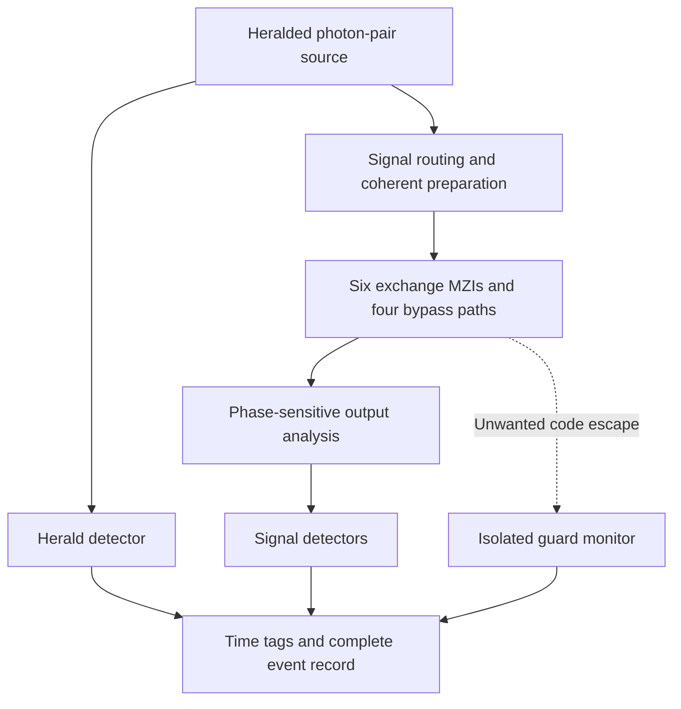

# First carrier design: a photonic balanced-exchange prototype

Author: Monty. Version 0.9. Status: engineering design and exact transfer
checks; no fabricated device, lab run, procurement or measured fidelity.

The selected first prototype encodes the native balanced exchange in a
single photon distributed across optical paths. The grid-4 design has
**16 code paths, six exchange interferometers, four bypass paths and one
isolated guard path**. It tests a specific coherent data/record interaction.
It is not the full four-mode calculator or a 2056-qubit architecture.

[Logical netlist](photonic_exchange_netlist.json) ·
[Unrun experiment protocol](photonic_exchange_protocol.json) ·
[Implementation](photonic_exchange.py) ·
[Qualification](register_qualification.json).

## 1. Engineering choice and evidence

Choose a silicon-nitride (\(\mathrm{Si_3N_4}\)) path-interferometer core,
nominally around 1550 nm, with thermo-optic phase control, an external
heralded SPDC photon-pair source and SNSPD detection/time tagging.
This is a design choice, not a physical law deduced from the native theory.
It follows the particularly simple optical factorization in Section 3.

The component class has experimental precedent:

- [Taballione et al., Quantum 7, 1071 (2023)](https://arxiv.org/abs/2203.01801v5)
  report a reconfigurable 20-mode SiN processor with classical calibration
  and quantum interference tests. Their setup uses telecom photon pairs
  from an external SPDC source. This supports the component scale, not the
  performance or availability of this custom design.
- [Clements et al.](https://arxiv.org/abs/1603.08788) establish optical
  unitary decomposition using beam splitters and phase shifters. The
  six disjoint blocks here need no general universal mesh for the exchange
  core itself.
- [PsiQuantum team, Nature 641, 876–883 (2025)](https://www.nature.com/articles/s41586-025-08820-7)
  demonstrate heralded generation, interferometers and photon detection.
  Their reported quantum benchmarks distinguish detection-conditioned
  figures from loss. Their superconducting detector implementation uses
  cryogenic hardware.

No published fidelity, loss or clock rate is assigned to our prototype.
The selected SNSPD system needs its detector cooling infrastructure;
an optical core does not make the whole apparatus a room-temperature PC.
Existing IBM/Qmet evidence in this repository concerns other devices and
does not validate this optical design.

## 2. Exact codebook and its restricted domain

Fix the sum \(q=x_j+x_b\bmod L\), the reference \(a\), and the two other
native modes at zero. Define \(u=x_j-a\bmod L\), with pointer \(m\).
One optical path represents each pair \((u,m)\):
\[
p=uL+m,\qquad
|u,m\rangle_{\rm code}
\ \longleftrightarrow\
|1_p\rangle_{\rm optical},\qquad
x_j=a+u,\quad x_b=q-a-u\pmod L.
\]
Here \(|1_p\rangle\) is one signal photon in path \(p\), with all other
paths in vacuum. The prototype uses \(L=4,q=0,a=0\). Its core dimension is
16: two bits for the independent data label and two for the pointer.
The paths are not 16 independent qubits.

The v0.8 balanced exchange becomes
\[
P|u,m\rangle=|m,u\rangle.
\]
At fresh \(m=0\), the data coordinate becomes zero and the old value \(u\)
is retained in the pointer label. In original labels this is
\((x_j,x_b,0)\mapsto(a,x_b+x_j-a,x_j-a)\).

Changing \(a\) or \(q\) changes the codebook. With fixed physical input/output
labels, that change requires appropriate routing or encoding calibration;
relabeling a file alone does not perform a physical reset to a new reference.
This is not a free conversion from arbitrary unknown states of four
independent physical carriers.

The guard path is outside the code. It has no assigned native phase tuple.
It detects optical code escape; it is not an independent measurement of a
four-mode physical closure charge.

## 3. Native generator to optical coupling

The exchange has \(L\) fixed paths \(p=uL+u\), and \(L(L-1)/2\) disjoint
two-cycles. For the grid-4 prototype:

| Interferometer | Coupled paths | Exchanged labels \((u,m)\) |
| --- | --- | --- |
| 0 | 1, 4 | (0,1) ↔ (1,0) |
| 1 | 2, 8 | (0,2) ↔ (2,0) |
| 2 | 3, 12 | (0,3) ↔ (3,0) |
| 3 | 6, 9 | (1,2) ↔ (2,1) |
| 4 | 7, 13 | (1,3) ↔ (3,1) |
| 5 | 11, 14 | (2,3) ↔ (3,2) |

Paths 0, 5, 10 and 15 are fixed bypasses. Path 16 is the isolated guard.
The code generator supplies this routing without duplicating a simulator.

On each two-cycle the native \(P\) is \(X\). Hence
\[
U(\theta)=\frac{I+X}{2}+e^{-i\theta}\frac{I-X}{2}
=H_{\rm B}
\begin{pmatrix}1&0\\0&e^{-i\theta}\end{pmatrix}
H_{\rm B},
\qquad
H_{\rm B}=\frac1{\sqrt2}\begin{pmatrix}1&1\\1&-1\end{pmatrix}.
\]
This is a Mach–Zehnder transfer matrix with calibrated balanced couplers
and an antisymmetric-arm phase \(-\theta\). At zero it is identity; at
\(\pi\) it is a real exchange. At \(\pi/2\) the diagonal and off-diagonal
amplitudes are \((1-i)/2\) and \((1+i)/2\).

A conventional balanced directional coupler can instead have
\[
D=\frac1{\sqrt2}\begin{pmatrix}1&i\\i&1\end{pmatrix}.
\]
With \(Z=\operatorname{diag}(1,-i)\), \(ZDZ=H_{\rm B}\). Thus fixed port
phases are part of the physical calibration, not an optional convention.
The logical count of six variable arm phases excludes extra port trims,
stabilization actuators and input/output analysis controls.

An equivalent ideal coupled-mode Hamiltonian for ports \(p,r\) is
\[
H_{pr}(t)=\frac{\hbar g(t)}2
\left(n_p+n_r-a_p^\dagger a_r-a_r^\dagger a_p\right).
\]
Restricted to their single-photon subspace it is precisely
\(\hbar g(t)(I-X)/2\). It uses passive hopping plus matched diagonal phase.
The diagonal term cannot be dropped as a global phase of the **entire**
device: it acts on this pair while the fixed paths bypass it.

This Hamiltonian and the MZI give the same target transfer. A fabricated
MZI's propagation through its two couplers is not generally the exact
laboratory-time path \(H_{pr}(t)\); its constituent couplers nevertheless
stay inside the same paired optical-path subspace in the ideal model.
Static heater setting, photon transit time and native time are different
quantities and require separate calibration.

## 4. What continuous closure means in this prototype

Every code path carries the same declared pair sum \(q\), and the guard is
uncoupled during the ordinary experiment. Ideal propagation through the
disjoint code blocks remains inside the encoded sector at every position.

However, the closure operator is a scalar on this fixed-\(q\) code.
**Any** unitary restricted to these 16 code paths preserves that encoded
closure. Closure alone therefore cannot certify the intended exchange.
The phase-sensitive transfer tests are essential.

This is an encoded realization of the native operator, not an experimental
derivation of closure from four independently measurable material phase
channels. A full implementation across all \(q\) values would represent
additional sectors explicitly. The one guard port checks escape from the
optical code, not which native charge a lost photon carried.

A generic 20-mode mesh can reproduce the desired endpoint matrix while
mixing through unused modes internally. Its endpoint match does not
establish continuous confinement. The proposed exchange core uses disjoint
paired blocks and isolated bypass/guard paths.

The intentional guard-injection element must be physically bypassed or
removed for ordinary tests. Setting a Mach–Zehnder's net transfer to identity
does not imply its internal arms never populate the guard.

## 5. Apparatus and interfaces



| Subsystem | Selected role | What must be supplied before fabrication/run |
| --- | --- | --- |
| Photon source | External heralded SPDC source, nominal telecom signal; filtered pump/signal/idler | Wavelength, bandwidth, polarization, heralding rate, multiphoton statistics and optical compatibility |
| Input system | Route basis inputs and prepare coherent pairs of code paths | Preparation phases, path-delay matching and calibrated input transfer |
| Exchange core | Six two-path MZIs, twelve balanced couplers, four bypasses | SiN process kit, cross-section, lengths, bends/crossings, coupler dispersions and phase trims |
| Control | Computer plus phase-driver electronics and temperature stabilization | Measured phase-voltage/temperature maps, settling behavior and cross-talk compensation |
| Analysis | Direct path detection and coherent two-path analysis against a bypass | Relative block/port phase calibration, detector routing and analysis settings |
| Detectors | SNSPDs, cryogenic support and time tagger | Efficiencies, dark counts, dead time, timing response and coincidence-window rules |
| Guard test | One outside-code path and separately bypassable injection optics | Isolation in normal operation and known injected transfer in the negative control |
| Evidence record | Per-herald outcome categories and immutable configuration/calibration identifiers | All losses, rejected windows and accidental/background estimates retained |

Parallel monitoring uses 17 signal/guard output channels plus one herald
channel: 18 detector channels in that configuration. Switched/scanned
detection can reuse detectors, but adds switching loss and time-drift
accounting. It is not equivalent to simultaneous monitoring without a
declared acquisition protocol.

The six-MZI count is the exchange **core**, not the complete apparatus.
Preparation, analysis, source, port trims, guard-injection optics and any
second pass are additional. Their total counts depend on the chosen layout.
No cost, footprint, tolerances, performance or delivery estimate is asserted.

The netlist intentionally leaves foundry dimensions, heater maps, measured
wavelength, loss and cross-talk unset. It is a logical optical netlist, not
a fabrication-ready GDS mask. Those parameters require a process design kit
and calibration data; they cannot be inferred from a phase-label theorem.

## 6. Measurement plan and acceptance logic

The generated protocol contains **106 proposed settings**:

| Family | Settings | Purpose |
| --- | ---: | --- |
| All 16 basis inputs at angles 0, π/4, π/2, 3π/4, π | 80 | Transfer populations, leakage monitoring and fixed-path behavior |
| Six exchanged pairs against a fixed bypass, four analyzer phases each | 24 | Relative complex phase and coherence across blocks |
| Physically bypassed and half-transfer guard controls | 2 | Verify outside-code monitoring and a known leakage response |

For each MZI, prepare \((|p\rangle+|f\rangle)/\sqrt2\), where \(f=0\) is a
fixed bypass. At the completed exchange the ideal output is
\((|r\rangle+|f\rangle)/\sqrt2\). Analysis in
\((|r\rangle\pm e^{i\phi}|f\rangle)/\sqrt2\) gives
\[
p_+(\phi)=\frac{1+\cos\phi}{2},\quad
p_-(\phi)=1-p_+(\phi).
\]
At \(\phi=0\), the correct exchange gives \(p_+=1\), while an incorrectly
phased \(iX\) exchange gives \(1/2\), despite identical endpoint populations.
A dephased mixture also gives \(1/2\). The four analyzer phases distinguish
these failures more fully.

The guard control at half-transfer predicts probability \(1/2\) in the
guard under the ideal test-coupler model. This is a deliberate optical
code-leakage test, distinct from the v0.8 native-charge negative control.
The source and detector characterization must determine how it appears in
raw counts, including loss and accidentals.

These settings are targeted characterization, not complete 16-dimensional
process tomography. Before a physical acceptance decision, declare shot
counts, confidence intervals, drift treatment and tolerances based on the
calibrated apparatus. They are unset in the generated protocol; no synthetic
result is labelled as a lab measurement.

Each admitted herald window belongs to exactly one category:
one core-path click, one guard-path click, no click, or multiple clicks.
`observed_rates` checks that these counts sum to all herald windows and
reports their unconditional fractions. A core-only output distribution is
separately labelled as conditioned on a core click. It never declares
physical acceptance or computes confidence from bookkeeping alone.

Bright-light calibration can determine the optical transfer matrix.
Quantum-carrier qualification additionally needs a characterized heralded
single-photon source and appropriate photon statistics, such as a heralded
second-order correlation measurement. A single-photon path experiment does
not by itself demonstrate computational advantage or inter-photon gates.

## 7. Retained record, detection and scaling

The pointer is an internal degree of freedom of the same photon. Before
detection its coherence remains in the optical paths. Ordinary photon
detection destroys that shared carrier; this design does not implement
the calculator's nondestructive mid-circuit pointer measurement.

Coherent recovery can be tested with a second exchange pass followed by
inverse preparation, while keeping the photon undetected. That requires
a second core bank or a calibrated loop/switch, outside the six-MZI core
budget. A deliberately randomized pointer-dependent phase between passes
would test loss of recoverable coherence. No record erasure, photon storage
time or recycling mechanism is supplied by the static layout.

| Encoding scope | Core paths |
| --- | ---: |
| One fixed-sum pair + one pointer, grid 4 | 16 |
| Same restricted scope, grid 8 | 64 |
| Same restricted scope, grid 64 | 4096 |
| All pair sums + one pointer, grid 4 | 64 |
| Full four-mode fixed-sum sector + one pointer, grid 4 | 256 |
| Full four-mode fixed-sum sector + one pointer, grid 64 | 16,777,216 |

For the restricted pair, each additional independent retained pointer
multiplies the path count by \(L\). General \(n\)-qubit state storage in
single-photon path encoding requires \(2^n\) paths. Consequently this route
is a useful interaction demonstrator, not a scalable replacement for
independently composed quantum carriers. Scalable multi-photon entangling
operations, error correction and a 2056-qubit device require a separate
architecture.

## 8. Implementation and qualification

`design_photonic_exchange` generates the codebook, disjoint pairing, guard,
core resource counts, exact scattering columns, netlist and experiment plan.
It supports power-of-two grids admitted by the existing compiler subject to
a 4097-path cap; grid 64 fills that cap. It reuses existing exact pulse
coefficients and has no evolving-state backend.

```python
from phase_seam_foundation.photonic_exchange import design_photonic_exchange

design = design_photonic_exchange()
assert len(design.pairs) == 6
assert design.fixed == (0, 5, 10, 15)
assert design.guard == 16
# Target=1, reservoir=3, fresh pointer=0 -> target=0, reservoir=0, pointer=1.
source = design.encode(1, 3, 0)
assert design.decode(design.partner(source)) == (0, 0, 1)
assert design.experiment_plan()["settings_count"] == 106
```

The combined audit passes **181 tests in 111.008 seconds**, with no failures,
errors or skips. The 11 new checks cover native exchange matching for every
grid-4 codebook/pointer; full path partitions through grid 64; clean reset
record retention; exact MZI transfer through the existing phase engine;
native fractional-circuit agreement; common-phase/dephasing detection;
protocol normalization; complete count accounting; and tampering/resource
guards.
All 170 earlier targeted checks remain included. Full native/Shor suites
and hardware jobs were not rerun.

Run `python benchmarks/phase_seam_register_audit.py` to regenerate the
qualification, logical netlist, proposed protocol and source hashes.
The source and layout verifiers are consistency checks, not physical
certification or independent formal provers.

Closed: a carrier-specific encoded interaction design, its optical
factorization, explicit resource growth and a reproducible lab protocol.
New choices: SiN path encoding, telecom operating target, external heralded
source, detector system and the restricted fixed-pair domain.
Open: fabricated hardware, complete preparation/analysis layout, measured
calibration and acceptance, independent physical native modes, nondestructive
record readout and scalable quantum-computer architecture.
