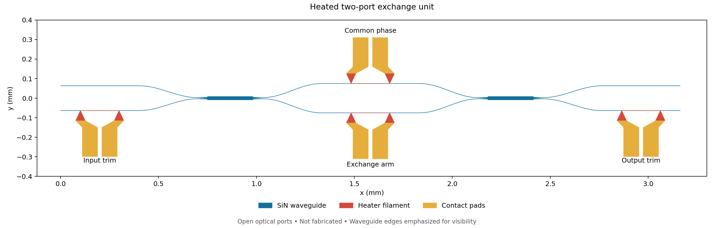
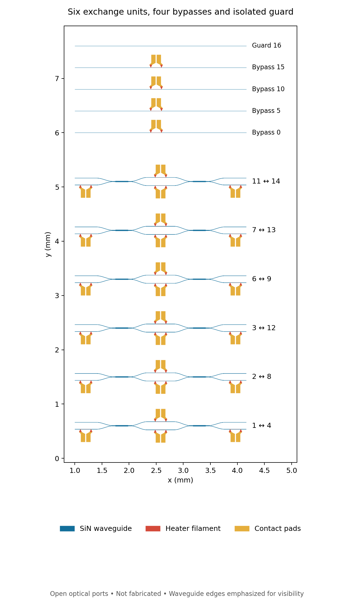

# Heated optical core: geometry and physical controls

Author: Monty. Version 0.11. Status: generated GDS core subassembly and local
geometry checks; no fabrication submission, packaged apparatus or lab data.

[GDS](layout/exchange_core.gds) · [Ports and controls](layout/exchange_core_ports.json) ·
[Geometry qualification](layout/layout_qualification.json) ·
[31-channel calibration template](layout/physical_calibration_template.json).



## 1. What is now drawn

The generated hierarchy contains six two-input exchange units, four separate
bypass guides and one isolated guard. It has **12 MMI couplers, 28 heaters,
56 electrical contact pads and 34 open optical ports**. Each unit is 3.164 mm
long between its optical interface planes. The full array is placed inside
an 11.47 × 15.45 mm design outline; that outline is not the occupied core
footprint or the final packaged-die size.

The physical row order groups the paired labels together, rather than
sorting the native path numbers. The JSON port map provides both ends of
every label. There are no intentional optical crossovers between units.
The input/output interface pitch within a pair is 127 μm; this is a chosen
open-port spacing, not a designed fiber-array coupling interface.

The MMI and heater polygons are imported unchanged from two hash-pinned
GDS components in the [same PDK revision](photonic_process_binding.json).
Their upstream MIT license and attribution are retained in
[the vendor directory](layout/vendor/cornerstone_sin300/README.md).
The new work places those cells and adds symmetric cosine S-bends and
straight waveguides. The gdsfactory Python package itself is not executed.

The two arms have symmetric geometrical routing. That alone does not
establish equal optical phase, loss, polarization or temperature response.
The minimum analytic centerline radius of the chosen S-bends exceeds 250 μm;
no bend-loss or Maxwell calculation is claimed.

The GDS ends at open waveguide interfaces. Fiber/edge couplers, packaging,
external preparation/analysis/guard optics, electronics and source/detector
hardware remain outside this subassembly. It is not ready to send for
fabrication as a complete experiment.

## 2. Why the physical core needs more controls

The logical exchange uses calibrated Hadamards. A conventional ideal
balanced directional-coupler convention instead has
\[
D=\frac1{\sqrt2}\begin{pmatrix}1&i\\i&1\end{pmatrix},\qquad
Z=\operatorname{diag}(1,-i),\qquad H=ZDZ.
\]
Consequently the same native exchange can be written
\[
U_\theta
=Z D\operatorname{diag}(1,-e^{-i\theta})D Z.
\]
This specifies input/output phase trims of −π/2 on the second path and
an internal relative phase π−θ. The physical arm offset is part of the
calibrated convention; it must not be silently confused with the logical
Hadamard-arm phase −θ.

We draw four heaters per exchange: the lower exchange arm, the upper common
phase arm, and second-path input/output trims. The upper arm provides a
degree of freedom for calibrating phase relative to the bypass paths.
Four additional bypass heaters permit reference-phase adjustment.
That gives 24 + 4 = **28 on-chip heater channels**. The six logical exchange
angles still represent six logical targets; they are not the entire
physical actuator inventory.

`physical_phase_targets` returns the ideal D-convention targets in π/32
units: lower arm 32−θ_steps, upper arm zero, input/output trims 48, and
bypass references zero, all modulo 64. These zero targets do not imply zero
voltage. Propagation and component phase offsets, imperfect splitting and
thermal interactions require measured calibration. The ideal D matrix is
a modeling assumption, not a measured transfer matrix of the imported MMI.

The existing exact calculator verifies the phase-word identity at all 64
sampled angles for both inputs. The displayed algebra establishes the
identity for arbitrary θ under the ideal coupler assumption.

## 3. Local checks and their scope

The layout generator uses gdstk. A separate KLayout database reader parses
the written GDS and checks its merged geometry. The current checks cover:

- allowed layers, the 1 nm database grid and containment in the design outline;
- selected waveguide, heater and pad minimum widths and gaps;
- the expected optical connectivity partition: six paired components plus
  four bypass components and one guard component;
- 28 filament components and 56 separate pad components, with two pads per
  heater and one heater per pad;
- lateral alignment of the central heater strip with its intended guide.

The dimensional reference is the [CORNERSTONE SiN300 MPW13 June 2026
guideline](https://cornerstone.sotonfab.co.uk/wp-content/uploads/2026/06/CORNERSTONE-Silicon-Nitride-MPW-13-Design-Guidelines.pdf),
especially pages 8–12. Our local thresholds are 350/250 nm for SiN
width/gap, 600 nm/5 μm for filament width/gap, and 2/5 μm for pad width/gap.
No cladding opening is drawn. The optical reference plane and bond-pad
interfaces remain open by design.

These are **local geometry checks**, not a run of the proprietary foundry
pre-DRC macro or the complete foundry deck. Width/gap checks use a limited
edge-angle criterion; they do not cover every manufacturing rule. The
downloaded macro was inspected for context but is not redistributed.
Its archive filename says v3_0 while its internal header says version 4.0;
both source URL and archive hash are recorded in the audit.

Negative tests deliberately break a waveguide, short the guard to a bypass,
bridge two pads, displace a heater, add an undersized feature, use an unknown
layer and tamper with a vendor file. These must fail. Another test checks
deterministic GDS generation. No local pass is labelled foundry approval.



The plot emphasizes waveguide edges for visibility. The GDS retains the
actual polygon widths. The drawing contains no simulated optical fields.

## 4. The calibration interface now has physical scope

The v0.10 nine-channel logical profile remains supported. It is insufficient
to command this physical subassembly. The new **v2 profile covers all 31
channels**: 28 chip heaters and the three external preparation, analysis
and guard phases. Every row must contain the complete recorded voltage
vector, including bias/trim channels that may need to change to compensate
cross-talk. No independent-heater assumption is introduced.

Call `calibration_template(physical_layout=True)` to obtain the unmeasured
v2 template. Use `calibration_target(id, physical_layout=True)` for its
target fingerprint, and `compile_drive_plan(..., physical_layout=True)`
when binding a recorded profile. The physical scope is explicit: v1 data
cannot silently be accepted as a complete physical profile.

Both the actual GDS byte hash and the layout-specification hash are bound,
alongside the previous I/O, device, context, validity and raw-evidence
references. A changed geometry or a logical-only target fails binding.
The output is still an offline plan; no instrument is driven. The saved
template contains no measured voltages, and test profiles remain synthetic.

```python
from phase_seam_foundation.photonic_io import calibration_template, calibration_target

profile = calibration_template(physical_layout=True)
assert len(profile["actuator_map"]) == 31
assert profile["status"] == "UNMEASURED_TEMPLATE"
target = calibration_target("basis_16_1", physical_layout=True)
assert target["physical_phase_targets_pi_over_32"]["core_0"] == 16
assert target["physical_phase_targets_pi_over_32"]["core_0_input_trim"] == 48
```

## 5. Reproduction and remaining engineering

The register audit passes **199 tests in 123.801 seconds** with no failures,
errors or skips. The separate CAD audit passes **9 tests in 1.686 seconds**.
All earlier 193 targeted calculator checks are retained. Full native/Shor
suites and hardware jobs were not rerun.

The calculator itself retains its existing dependencies. CAD generation and
geometry checks use the optional packages in `layout/requirements.txt`.
With those installed for Python 3.12:

```bash
python benchmarks/photonic_layout_audit.py
python benchmarks/phase_seam_register_audit.py
```

Run the CAD audit first after geometry changes; the register report binds
its resulting qualification and GDS. The geometry and calculator test suites
are reported separately. GDS timestamps are fixed for reproducible bytes.

Closed: a reproducible heated core GDS, mapped optical/electrical interfaces,
local geometric connectivity checks with negative controls, the ideal
physical-phase conversion, and explicit complete-actuator calibration binding.

New choices: four heaters per exchange, four bypass trims, symmetric routing,
external open optical interfaces, and a pinned optional CAD toolchain.

Open: optical coupling/packaging, full foundry review, EM/thermal behavior,
measured phase/voltage/settling/loss and quantum qualification. The existing
single-photon encoding, destructive readout and unfavorable path-count
scaling remain. The geometry does not establish a scalable quantum computer.
