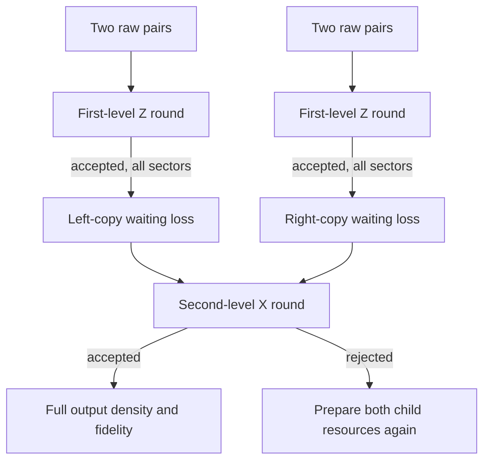

# Two noisy purification rounds with the full photon payload — v0.35

**Author: Monty.** Continues `dbb840a` (v0.34) on
`photonic-temperature-evidence-20261026`. No later collaborator commit was
present when this development started. The latest reviewed collaborator
packet is `90bc68d`, whose source-coherence correction is retained in v0.34.

[Code](purification_cascade.py) · [Tests](../tests/test_phase_seam_purification_cascade.py) ·
[Audit](../benchmarks/purification_cascade_audit.py) ·
[Results](cascade/qualification.json) · [Optical plan](cascade/netlist.json) ·
[Example full output state](cascade/payload_state.json) · [Test log](cascade/test_results.txt).

## 1. What is now connected

The previous packet priced faults in one purification round and used ideal
supplied pairs for multi-round schedules. This revision carries **every
heralded photon sector** from the first round into the second: vacuum,
single photons, valid two-qubit payloads, excess photons and coherences
within each local photon-number sector. A successful detector record does
not reset the output to a valid Bell-diagonal qubit state.

Two independent accepted first-round outputs feed the second round. Fixed
waiting losses can differ between those two copies. The model includes
uniform input loss at each level, inefficient photon-number-resolving
detectors, independent Bernoulli dark counts and the actual phase/H controls
acting on excess-photon states. Retry costs count false heralds too.

**Scope:** at most two noisy levels, starting with supplied, independent,
fully populated Bell-diagonal pairs. The bounds include up to eight output
photons, four at either site. No photon-number truncation is made. More than
two levels are rejected explicitly. Source preparation, random waiting
times, mode mismatch and measured hardware performance remain open.

## 2. Results for the declared 75%-fidelity source

The input Bell weights are `(3/4,1/12,1/12,1/12)`. Apply Z then X. Let m be
per-photon input transmission at **each** level, d detector efficiency, and
h a dark-count probability per mode and detector window. No additional
memory waiting is included in this table.

| m | d | h | Full final fidelity | Valid payload fraction | Expected raw pairs per final herald |
| ---: | ---: | ---: | ---: | ---: | ---: |
| 1 | 1 | 0 | 90.2361% | 100% | 32.1373 |
| 0.99 | 0.99 | 0 | 82.2723% | 91.1745% | 34.2700 |
| 0.99 | 0.99 | 0.000001 | 82.2721% | 91.1744% | 34.2702 |
| 0.999 | 0.999 | 0.000001 | 89.4303% | 99.1071% | 32.3498 |
| 0.9997 | 0.9997 | 0.000001 | 89.9941% | 99.7319% | 32.2012 |
| 0.9998 | 0.9998 | 0.000001 | 90.0747% | 99.8212% | 32.1800 |
| 0.9 | 0.9 | 0 | 31.8555% | 35.3024% | 60.2840 |

These are exact-model operating points, not measured efficiencies or a
globally optimal threshold. In particular, 99.98% at both m and d is one
tested point above 90% fidelity under these assumptions. Spectral overlap,
phase error and source certification could add further requirements.

For m=d=0.99 and h=10^-6, a finite comparison gives:

| Schedule | Final fidelity | Expected raw pairs |
| --- | ---: | ---: |
| Untouched supplied pair | 75% | 1 |
| Z or X | 76.0549% | 5.6745 |
| ZZ or XX | 65.9057% | 26.2064 |
| ZX or XZ | 82.2721% | 34.2702 |

The untouched-pair row uses no purification path or associated transmission
loss; it is not a comparison of complete experimental delivery systems.
More rounds are not automatically better. The audit enumerates precisely
these seven bounded schedule choices; it claims no general optimisation.

## 3. The hidden-postselection counterexample

With m=d=0.9 and no dark counts, the full two-round ZX output is

\[
 F=\frac{15327225}{48114809}=0.318555\ldots,\qquad
 P_{\rm valid\mid herald}=\frac{16985700}{48114809}=0.353024\ldots.
\]

Its fidelity **after an additional valid-payload selection** is still
`841/932 ≈ 90.24%`. That selection is not supplied by the detector record.

If the first-round state is projected onto one photon per site and
renormalised before entering the second round, the calculation instead
reports `1703025/2888201 ≈ 58.96%`. This inserts an extra nondestructive sector
flag absent from the device plan. It overstates the full-channel fidelity
by more than 25 percentage points. Such a flag would require an additional
physical implementation and its own cost/noise model; it cannot be free.

The public cascade always retains the whole state. `projection_bias` exposes
the extra-flag calculation only as an explicitly labelled negative control.

## 4. Full-state representation and exact channel

Represent a four-mode payload using creation monomials

\[
 |n)=\prod_{i=0}^{3}(a_i^\dagger)^{n_i}|0\rangle,\qquad
 (n|n)=\prod_i n_i!.
\]

The sparse density coefficients D satisfy
`rho = sum D[n,m] |n)(m|`. **Trace uses factorial Gram weights:**
`Tr(rho)=sum_n D[n,n] prod(n_i!)`. This is an exact change of basis, not a
replacement Born rule or an approximation to normalised Fock states. It
keeps the declared channel rational without requiring square roots of 3!
or 4! in every output amplitude.

The supplied source and the channel are block diagonal in each site's total
photon number. Off-diagonal rail coherences inside a block are preserved.
For pure loss with equal ket/bra lost occupations ell, each coefficient has
the factor

\[
 \prod_i {n_i\choose\ell_i}{m_i\choose\ell_i}\ell_i!
 \;\eta^{|n|-|\ell|}(1-\eta)^{|\ell|}.
\]

Here `|n|=|m|` in the supported blocks. Equal environment occupations are
summed coherently, as required by the v0.34 source correction.

The local H transform is the polynomial
`(x+y)^n0 (x-y)^n1 / sqrt(2)^(n0+n1)`. It acts on **all** photons in the two
rails. The fusion coupler acts on measured rails through
`(x+i*y)^n1 (i*x+y)^n2 / sqrt(2)^(n1+n2)`. Actual measured occupations are
traced with their factorial weights. For each possible observed single-click
record, its probability includes binomial detector thinning and a Bernoulli
dark count. Its native phase correction is applied once per photon in the
selected retained rail, including multiphoton sectors.

The native correction phases are 16 and 48 steps of pi/32. The coherent H
heater interface and local detector layout are unchanged from v0.34. For
this symmetric source/detector family, the complete corrected maps preserve
real rational density coefficients. General cross-number coherences or
arbitrary complex input states are outside this API.

The two local channels are contracted against two independent input-copy
states. Let the unnormalised accepted output be R. Then

\[
 p=\operatorname{Tr}R,\qquad \rho_{\rm next}=R/p.
\]

Normalisation is by **all accepted heralds**. No intermediate selection of
the `(1,1)` photon sector is inserted. If p=0, the API returns no conditional
state and no finite retry cost.

## 5. Circuit, supply and waiting



Rejected child preparations are retried before a parent attempt. If C is the
expected raw-pair cost of one accepted child and p the parent's actual
herald probability, its cost is `2C/p`. This counts invalid-payload heralds
as accepted outputs; it is **not** a cost per certified good Bell pair.
For two levels the probability that one whole fixed tree passes without
retries is `p1^2*p2`, while recursive retry cost is `4/(p1*p2)`.

At every level, including the first, the two input copies can have different
declared waits tL and tR. Their per-photon survivals are `m*mu^tL` and
`m*mu^tR`, with memory survival mu per declared round. No source completion
rate or distribution of random waiting times is inferred.

Example: m=d=0.999, h=10^-6, mu=0.99; the right copy has zero added wait:

| Left-copy wait at every level | Final fidelity | Expected raw pairs |
| ---: | ---: | ---: |
| 0 | 89.4303% | 32.3498 |
| 1 | 86.3275% | 32.9677 |
| 4 | 77.3175% | 34.7801 |
| 10 | 61.0475% | 38.2763 |

These fixed-age experiments isolate storage sensitivity. They do not close
the resource scheduler's random-latency problem.

## 6. Evidence and remaining work

```bash
python benchmarks/purification_cascade_audit.py
```

The audit saves exact results, full-state hashes, a representative complete
payload matrix, the optical plan, source hashes and a test log. Tests compare
every supported second-level local kernel with the existing permanent
engine, including four-photon bunching. The entire first-round density is
checked against v0.34 Fock trajectories. Other checks cover factorial
normalisation, pure-loss composition, full H transforms, matrix positivity,
all ideal two-level schedules, dark-only controls and the extra-sector-flag
counterexample. The earlier one-round, source, optical, encoded-transfer and
classifier-build tests run in the same audit.

The prior v0.34 ideal four-round value 98.56% remains an ideal result. This
revision makes **no noisy four-round claim**. Open work includes certified
raw sources, larger input photon sectors, more noisy levels, stochastic
resource preparation/waiting, imperfect mode matching and phases, the
12-photon encoded-resource factory channel and physical measurements.

The representation and loss maps follow established quantum-optical
methods. Prior art: [Ivan, Sabapathy and Simon, arXiv:1012.4266](https://arxiv.org/abs/1012.4266)
for bosonic Kraus channels, and [Pan et al., arXiv:quant-ph/0012026](https://arxiv.org/abs/quant-ph/0012026)
for linear-optical purification. The contribution here is the explicit
composition of this repository's instrument with its retained faulty
payloads, exact local Fock checks and reproducible evidence.
