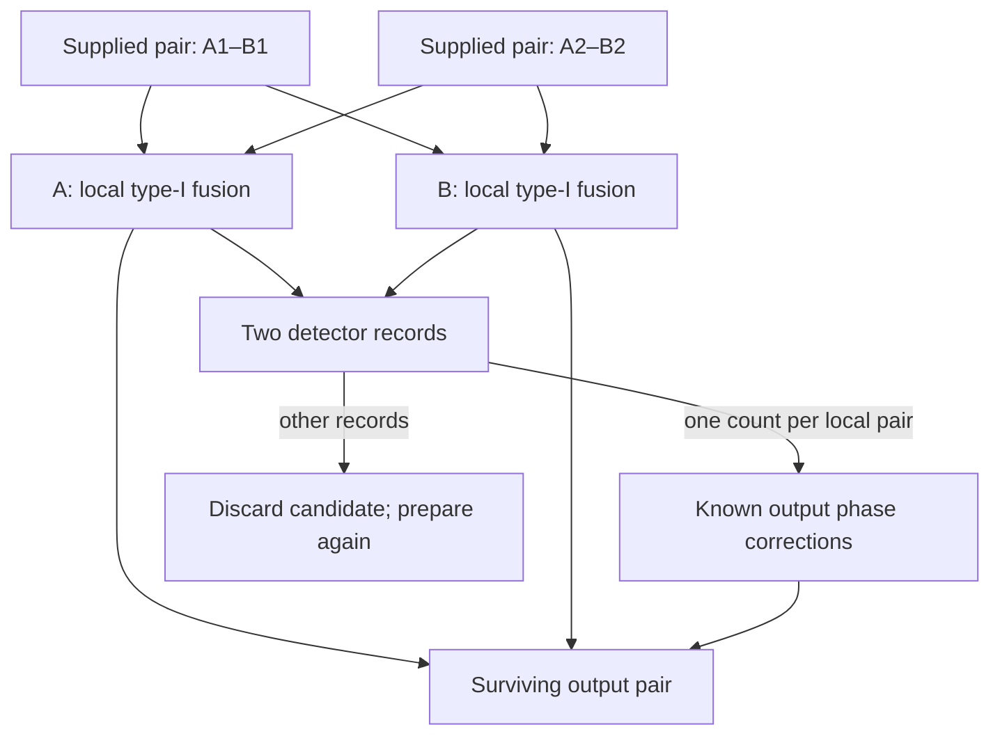

# Source coherence and an optical Bell-pair purification device — v0.34

**Author: Monty.** Reviews the collaborator's v0.33 commit `90bc68d` on
`photonic-temperature-evidence-20261026`. It corrects the source partial
trace, reuses the native type-I fusion and coherent heater interfaces, and
adds a purification device with an explicit accepted-output noise channel.

[Code](source_distillation.py) · [Tests](../tests/test_phase_seam_source_distillation.py) ·
[Reproducible audit](../benchmarks/source_distillation_audit.py) ·
[Results](distillation/qualification.json) · [Optical plan](distillation/netlist.json) ·
[Test log](distillation/test_results.txt).

## 1. Result and scope

Two existing type-I fusion units implement a two-copy Bell-pair purification
round. For **supplied, fully populated, independent** pairs with Bell weights
`(3/4,1/12,1/12,1/12)`, ideal alternating Z/X rounds give:

| Schedule | Conditional Bell fidelity | Expected supplied raw pairs per accepted output |
| --- | ---: | ---: |
| None | 3/4 = 75% | 1 |
| Z | 41/52 = 78.8462% | 72/13 = 5.5385 |
| ZX | 841/932 = 90.2361% | 7488/233 = 32.1373 |
| ZXZ | 354481/390212 = 90.8432% | 143.0774 |
| ZXZX | 62828777761/63748336772 = 98.5575% | 683.4921 |

Failed preparation attempts are included. The schedule assumes perfect
storage, controls and detectors; it supplies no elapsed time or measured
hardware fidelity. A separate **one-round** Fock channel includes input
loss, detector inefficiency and dark counts. Its full herald-conditioned
fidelity can be much lower than the fidelity after additionally selecting a
valid output. Invalid outputs are not treated as a usable next-round supply.

The selected double-pair source sector has exactly those Bell weights, but
selecting it on paper or destructively counting both photons does **not**
certify a reusable pair. Connecting this device to an actual source, or to
the 12-photon encoded factory, remains a separate engineering step.

## 2. Correction to v0.33: equal loss environments interfere

The declared double-pair input on `(A0,A1,B0,B1)` is

\[
 |\psi_2\rangle=(|2,0,2,0\rangle+|1,1,1,1\rangle+|0,2,0,2\rangle)/\sqrt3.
\]

Under independent uniform pure loss of transmissivity eta, condition on one
survivor per site. Each environment has lost one photon at A and at B.
Factoring out `eta*(1-eta)/sqrt(3)`, the survivor vectors for lost rails
`(0,0), (0,1), (1,0), (1,1)` are respectively

\[
 2|00\rangle+|11\rangle,\quad |10\rangle,\quad |01\rangle,\quad
 |00\rangle+2|11\rangle.
\]

The first vector contains two different input contributions with the **same**
environment state. Their cross term survives a partial trace. Summing the
four vector outer products gives

\[
 \rho_{11}=\frac1{12}
 \begin{pmatrix}5&0&0&4\\0&1&0&0\\0&0&1&0\\4&0&0&5\end{pmatrix},
 \qquad P_{11}=4\eta^2(1-\eta)^2.
\]

Thus XX = ZZ = 2/3, YY = -2/3, and the Phi+ fidelity is 3/4. The other three
Bell eigenvalues are each 1/12. At eta = 0 or 1 this event has probability
zero; the API returns no conditional state. An independent eight-mode,
four-photon beam-splitter dilation at eta = 1/2 obtains the same density
matrix directly from the repository's permanent engine.

The v0.33 diagonal matrix omitted the off-diagonal entries 4/12. It would
require additional dephasing absent from its stated input/loss model.
Fusing the actual surviving pair with a good Bell pair still succeeds with
probability 1/2, but the corrected GHZ output has **XXX = 2/3 and fidelity
3/4** for each detector click. Corrections are fixed by the instrument,
never chosen by inspecting the unknown input amplitudes.

For a declared one/double-pair mixture with double weight x, the selected
double-origin fraction is

\[
 w=\frac{4x(1-\eta)^2}{(1-x)+4x(1-\eta)^2}.
\]

This is an event-origin fraction, not state infidelity: the selected Bell
state has fidelity `1-w/4`, and an ideal subsequent GHZ merge has XXX
`1-w/3`. At small x, `w=4(1-eta)^2*x+O(x^2)`; the extra approximation
`w≈4x` also requires small eta. This x is not automatically a thermal pump
brightness or g2/2. Higher pair numbers and herald conditioning require
their own source statistics.

## 3. Physical purification circuit

Input ordering is `(A1,A2,B1,B2)`: pair 1 is A1–B1 and pair 2 is A2–B2.
Each site uses two optical rails. Interfere A1 rail 1 with A2 rail 0, and
B1 rail 1 with B2 rail 0. Accept one registered photon at each local
detector pair. Retain the other two rails at A and the other two at B.



The Fock-derived local click map, after its fixed phase correction, is

\[
 K_s=\alpha_s(|0\rangle\langle00|+|1\rangle\langle11|),\qquad
 |\alpha_s|^2=1/2.
\]

All four combined detector records are retained. A Z round uses two
couplers, four counted modes and two output phase controls. An X round
applies H to all four inputs and both outputs in addition. The coherent H
comes from `encoded_bell.basis_bridge_certificate`: heater steps
`(lower,upper,before,after)=(16,0,32,32)`, exact up to global phase on a
single-photon site. Each H uses two couplers, so an X round totals 14
couplers. Heater steps are not calibrated voltages or temperatures.

For Bell weights `(a,z,x,y)` in Phi+, Phi-, Psi+, Psi- order, let
`D=(a+z)^2+(x+y)^2`. The Z round has

\[
 P_Z=D/2,\qquad p'_Z=(a^2+z^2,\;2az,\;x^2+y^2,\;2xy)/D.
\]

For X, exchange z and x before and after that update. The factor 1/2 in
success is essential for this optical parity filter. It must not be
replaced by the higher success probability of a bilateral-CNOT protocol.
Repeating Z alone can amplify phase errors: for the example above, ZZ has
lower fidelity than Z. Alternating bases addresses both error types.

## 4. Failed attempts and supply cost

At each level, prepare two independent accepted previous-level pairs, then
attempt the next round. A failure consumes both. With expected raw-pair
cost C and next-round success P, the new cost is `2C/P`. Earlier successful
pairs may wait in **perfect memory**. This is a recursive retry policy, not
a claim of optimal cost or a policy restarting the entire binary tree.

The expected costs in section 1 include failed attempts but exclude raw
source postselection, switching, storage loss, faulty heralds and physical
preparation time. They cannot be inserted unchanged into the 192-pair
encoded-resource factory to obtain its output fidelity.

## 5. Noisy heralds: the entire accepted output is counted

`optical_round` starts with four supplied single photons in two independent
Bell-diagonal pairs. It enumerates:

1. Every lost-photon mask, grouping coherent amplitudes by actual lost rails.
2. The native Fock evolution through both local fusion units, including
   failure patterns with zero or two true detector photons.
3. Binomial detector efficiency d, plus an independent Bernoulli dark count
   (zero or one extra count) of probability h in each of four modes.
4. All observed records with exactly one registered photon per local pair,
   applying the phase correction associated with the **observed** clicks.

All unobserved true counts and loss environments are traced. The returned
matrix is the *unnormalised* valid two-qubit payload sector. Its trace is
reported separately from total herald probability. Conditional fidelity
divides target overlap by **all** accepted heralds; vacuum and excess-payload
sectors have zero overlap with the two-photon Bell target. The API also
reports valid-sector fidelity, but does not treat that selection as an
available nondestructive flag.

For perfect Phi+ inputs, no dark counts, per-photon input survival m and
detector efficiency d, an independent count argument gives

\[
 P_{\rm herald}=(md)^2[1/2+(1-md)^2],\qquad
 P_{\rm valid}=m^4d^2/2.
\]

The three initial local detector-count sectors `(1,1), (0,0), (2,2)` have
weights 1/2, 1/4, 1/4. Loss or inefficient counting can turn `(2,2)` into
apparently accepted counts while leaving an empty output. Consequently:

| Perfect input pairs; h=0 | Herald probability | Valid payload probability | Full conditional fidelity |
| --- | ---: | ---: | ---: |
| m=1, d=1 | 1/2 | 1/2 | 1 |
| m=1, d=0.9 | 0.4131 | 0.405 | 50/51 = 98.0392% |
| m=0.9, d=1 | 0.4131 | 0.32805 | 27/34 = 79.4118% |

For the 75%-fidelity supplied input mixture, a single Z round gives:

| m | d | h per mode | Herald probability | Full conditional fidelity |
| ---: | ---: | ---: | ---: | ---: |
| 1 | 1 | 0 | 0.361111 | 78.8462% |
| 0.99 | 0.99 | 0 | 0.352456 | 76.0550% |
| 0.99 | 0.99 | 0.000001 | 0.352455 | 76.0549% |
| 0.9 | 0.9 | 0 | 0.288001 | 52.5392% |

Thus purification helps only when its component quality and supply justify
it. More postselection alone is not an accuracy improvement. With all input
photons lost, dark counts can still herald: probability `[2h(1-h)]^2`,
fidelity zero. With d=0 and nonzero darks, perfect supplied inputs yield
full conditional fidelity 1/4, testing that random detector reports cannot
retain the needed phase information.

## 6. Existing fault ledger and open engineering work

The v0.33 storage/switch models are retained. Its diagonal-source claim,
zero fused coherence, general g2-to-double-weight conversion and 13-node
physical witness interpretation are withdrawn. `cluster_fault_ledger`
retains its numbers only as a named independent zero-response **toy score**.
`fault_grade` stops at NODE_FAULTS_RECORDED pending the source-conditioning
map and actual circuit-level noise channel. The updated audit and historical
documents make this correction explicit; v0.33 remains in Git history.

Still open: a certified reusable raw source; higher source-pair sectors;
imperfect spectral overlap/phase control; correlated noise; composing
payload-invalid outputs over multiple rounds; realistic storage and
scheduling; noise propagation through the 12-photon encoded Bell factory;
and physical component measurements. The one-round device channel does not
close the classifier's complete noise budget.

## 7. Evidence and prior art

```bash
python benchmarks/source_distillation_audit.py
python benchmarks/cluster_faults_audit.py
```

The audit records source hashes, the reviewed commit, exact rational results,
the optical plan and test log. Checks include an independent loss dilation,
all four detector Kraus maps against a global eight-mode Fock circuit,
recurrence against density contraction, every Bell-label/loss-mask trajectory,
dark-only and detector-failure controls, and the existing encoded-transfer
and optical/classifier interfaces. No experiment or laboratory qualification
is inferred from these tests.

Pure-loss Kraus channels and linear-optical purification have established
prior art. This revision contributes their explicit implementation and
correction within this repository's declared instrument and evidence chain:

- Ivan, Sabapathy and Simon, *Operator-sum Representation for Bosonic Gaussian
  Channels*, Phys. Rev. A 84, 042311 (2011),
  [arXiv:1012.4266](https://arxiv.org/abs/1012.4266).
- Pan, Simon, Brukner and Zeilinger, *Feasible Entanglement Purification for
  Quantum Communication*, Nature 410, 1067–1070 (2001),
  [arXiv:quant-ph/0012026](https://arxiv.org/abs/quant-ph/0012026).

No first-in-world purification claim, universal accuracy guarantee or
measured device performance is made.
